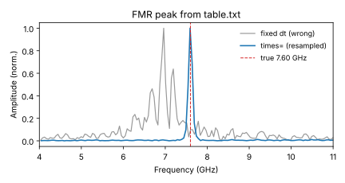
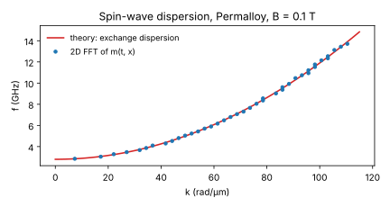

# mx3sw: spin-wave tools for MuMax3

[](https://github.com/Dark-atoms/mumax3-spinwave-tools/actions/workflows/tests.yml)
[](https://doi.org/10.5281/zenodo.24375849)

Small, tested Python helpers for the analysis steps that come up in almost every
[MuMax3](https://mumax.github.io/) spin-wave simulation:

- **Read output**: `table.txt` → pandas DataFrame, and OVF files (2.0 text / binary 4 / binary 8, OVF 1.0) → NumPy, without needing `mumax3-convert`
- **Spectra**: windowed FFT of a time signal and its peak frequency (FMR, mode frequencies), with resampling for the uneven save times of `table.txt`
- **Dispersion**: 2D FFT of m(t, x) → f(k) map
- **Wavelength**: from peak spacing along a spin-wave profile
- **Theory checks**: in-plane Kittel formula, exchange dispersion, Kittel fit for Msat
- **Run**: write a script, run MuMax3, get the table back

The OVF reader gives arrays shaped `(component, z, y, x)`, the same layout as `mumax3-convert -numpy`.

## Install

```bash
git clone https://github.com/Dark-atoms/mumax3-spinwave-tools
cd mumax3-spinwave-tools
pip install -e ".[plot,test]"
```

Analysis functions work on any machine. Running simulations (`run_mumax3`, the examples) needs MuMax3 and an NVIDIA GPU.

## Quick start

```python
import mx3sw

# FMR frequency from the average magnetisation
table = mx3sw.read_table("sim.out/table.txt")
# pass the time column: rows are resampled to an even grid first,
# because MuMax3's adaptive solver saves at slightly uneven times
print(mx3sw.peak_frequency(table["mx"], times=table["t"]) / 1e9, "GHz")

# Dispersion map from saved snapshots
files, m = mx3sw.read_ovf_series("sim.out", "m*.ovf")   # (time, 3, z, y, x)
mx_line = m[:, 0, 0, m.shape[3] // 2, :]                # m_x along the centre line
k, f, power = mx3sw.dispersion_map(mx_line, dt=25e-12, dx=10e-9)
```

## Examples

Both figures below come from [`examples/tutorial.ipynb`](examples/tutorial.ipynb), which runs in seconds on synthetic data (no MuMax3 or GPU needed).



*Left as is, the uneven save times in `table.txt` move the FMR peak by about 8% here; `times=` recovers the true frequency.*



*The 2D FFT ridge of m(t, x) follows the analytical exchange dispersion. A wave travelling in +x appears at k > 0, f > 0.*

| Script | What it shows |
|---|---|
| `examples/tutorial.ipynb` | Step-by-step: FMR frequency from `table.txt`, dispersion from m(t, x) |
| `examples/01_permalloy_dispersion.py` | Sinc-pulse excitation in a Permalloy waveguide, f(k) map vs. exchange theory |
| `examples/02_kittel_sweep.py` | FMR frequency vs. bias field, Kittel fit recovers Msat |

## Tests

```bash
pytest
```

The tests use synthetic data (OVF round-trips, known sine waves, known Kittel curves), so they run without MuMax3. The OVF reader was also checked against `mumax3-convert -numpy` output from a real simulation.

## Formulas

- Kittel (in-plane thin film): f = γ/2π · √(B (B + μ₀Mₛ))
- Exchange dispersion: f = γ/2π · (B + 2A_ex k² / Mₛ)

Dipolar contributions are not included in `exchange_dispersion`; use it as a guide for short wavelengths.

## How to cite

If you use mx3sw in work that leads to a publication, please cite it.
GitHub's **"Cite this repository"** button (right sidebar) gives APA and BibTeX from [`CITATION.cff`](CITATION.cff), or use:

```bibtex
@software{mandal_mx3sw_2026,
  author  = {Mandal, Subhrojyoti},
  title   = {mx3sw: spin-wave analysis tools for MuMax3},
  version = {0.1.0},
  year    = {2026},
  doi     = {10.5281/zenodo.24375849},
  url     = {https://github.com/Dark-atoms/mumax3-spinwave-tools},
  license = {MIT}
}
```

If you copy or adapt the code, the MIT license requires keeping the copyright notice in [LICENSE](LICENSE).

## Contributing

Issues and pull requests are welcome, especially other analysis steps you repeat in your own MuMax3 work.

## License

MIT. See [LICENSE](LICENSE).
